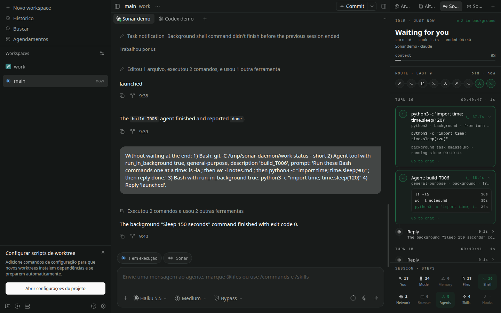
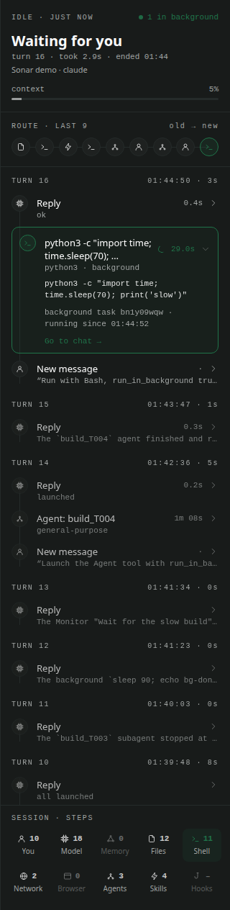
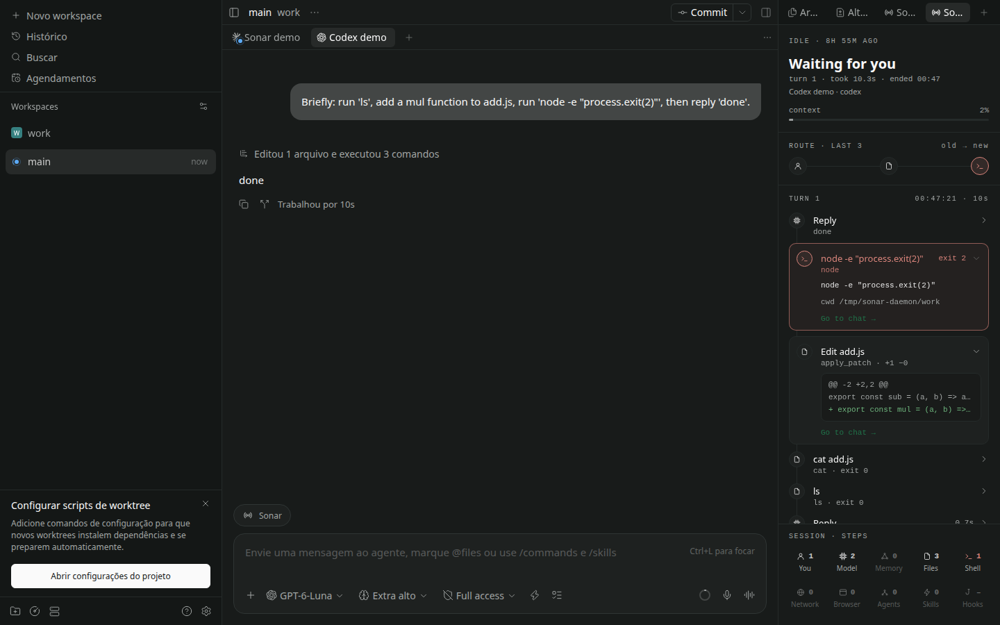

# Sonar for Paseo

A Paseo plugin that docks a live trace of an agent's work beside the chat. Each tool call, message and reply becomes a row on the station it belongs to, so you see where the work goes (files, shell, network, memory, subagents) and what is running right now, instead of reading the transcript.



Screenshots show a throwaway demo project and agents.

## What it shows

| Background work, open | A Codex agent |
| --- | --- |
|  |  |

- **Now**: how long the turn has run, what runs right now, and the newest call as a headline (`Running npm test`, `Editing vitest.config.ts`) with its station, tool, facts and elapsed time. A light sweeps under it while the agent works, and a second call running at the same time gets its own line. At rest it says `Waiting for you`, how long the last turn took and when it ended; the right of the clock says what still runs (`2 running`, `1 in background`) and nothing when nothing does. Under it, a bar shows the context window in use, amber from 70% and red from 90%.
- **Background work**: a command run with `run_in_background`, a `Monitor` waiting for an event, and an `Agent` launched in the background stay live after the turn that started them, with a spinner and their time running, at the top of the newest turn. The task's notice of its end closes the row with its real length and exit code, also in history. A background subagent shows its last three steps.
- **Route**: the last nine stations the work went through, oldest on the left. Model steps show only while they run, or every leg would pass through Model. A live station is lit in the accent color, a failed one is red.
- **Turns**: the newest turn whole, newest row on top; earlier turns dimmed, with four rows and `+N earlier steps` to open the rest. A command is named by what it does, `dispatch_driver.py finish T002` rather than `python3 -B /home/…/7d1a…/dispatch_driver.py`, with what ran it and how it ended under it (`python3 · exit 0`) and its time on the right. Thinking under a second and empty replies are left out. A failure is never folded away.
- **Open a row** to see more: a command's full line, its folder and the end of its output (`full output (38 lines)` for all of it); an edit's diff (`+ 9 lines` for the rest); a background task's id and when it started or ended; a subagent's task and last steps; a message, reply or thinking in full; and a tool's input and output. Live rows and recent failures stay open; the others open one at a time. **Go to chat →** brings the agent's chat to the front.
- **Counts**: how many rows each station has had in the session (`SESSION · STEPS`; `RECENT` when only the latest 3,000 entries are loaded), lit while one of them runs and red after a failure in the last turn.

### Stations

| Station | When |
| --- | --- |
| You | your messages, questions to you, the task list and plans |
| Model | replies, thinking, context compaction |
| Memory | Claude Code's memory folder and MCP servers named like `memory` |
| Files | reads, writes, edits, searches, and shell commands that only work on files (`cat`, `grep`, `ls`, `sed`, `mv`, `rm`…) |
| Shell | every other shell command |
| Network | web fetch and search, MCP servers, and commands known to reach the network (`curl`, `gh`, `ssh`, `git push`, `npm install`…) |
| Browser | Paseo's browser tools, Playwright, Chrome DevTools and other browser MCP servers |
| Agents | subagents, workflows and schedules |
| Skills | skills and tool loading |

It works with every provider Paseo runs, because it reads Paseo's own timeline rather than a provider's logs. How much a row says depends on what the provider reports: Claude does not report a fetch's status or size, Codex reports exit codes and diffs, and an agent that reports a tool by name only gets a plainer row.

## Open it

- Press **Sonar** above an agent's composer.
- Or type `/sonar` in the composer, or choose **Open Sonar** in the Command Center (**Ctrl+K**, **⌘K** on macOS).

Sonar opens in the Explorer, beside the chat, and follows the agent it was opened from. Each agent has its own Sonar tab; it reopens with the workspace.

## Limits

- **One panel per agent.** Paseo 0.15 does not tell a plugin which agent tab has focus, so a panel cannot follow the tab you switch to, and it does not open by itself. Paseo 0.16 adds what is needed; Sonar will move to one panel that follows the focused agent then.
- **Times from history.** Paseo's timeline keeps one time per tool call, when it started. Sonar times the calls it watches and keeps those times in the tab's state, so they survive a reload; a call that ran while no Sonar tab was open shows no time. Background tasks get theirs from their notice of the end, and turn lengths are always shown.
- **Subagents already running.** Paseo 0.15 sends plugins each subagent's updates but not the list of those already running, so the steps of a subagent that was working before the panel opened show from its next one on. The row itself is live from the start when the agent launched it in the background with a notice to follow.
- **Hooks.** Claude Code hooks do not reach Paseo's timeline, so the Hooks tile shows `–`.
- **Exit codes.** Codex reports them. Claude reports a failure, not its code, for a call in the foreground; Sonar reads the code from the failure's text when it is there, and shows `exit 0` for Claude's successful commands.
- **Fonts.** Sonar uses Paseo's interface font. Its small labels use the system monospace font: Paseo does not pass its monospace setting to plugins.

## Requirements

Paseo 0.15 or later, on the daemon and in the app.

## Install

Install the published package:

```bash
paseo plugin install npm:@drungrin/paseo-sonar
```

Or install from Git:

```bash
paseo plugin install git:drungrin/paseo-sonar
```

The plugin has only a client part and no dependencies to install.

### Install locally

Clone this repository and point Paseo at the checkout:

```bash
git clone https://github.com/drungrin/paseo-sonar.git
cd paseo-sonar
paseo plugin install "$(pwd)"
```

## Privacy

Sonar reads the agent's timeline, its state and its subagents' updates through the connection the Paseo app already has. It makes no network requests of its own, runs no commands, reads no files and adds no daemon process. It keeps only the length of the tool calls it watched, in the Sonar tab's saved state.

## Development

```bash
npm install
npm test
npm run typecheck
```

`client/shell.ts` reads shell command lines into commands, for their titles and stations. `client/classify.ts` turns a tool call into a station, a title and facts. `client/model.ts` keeps turns and rows from history and live events and builds what the panel draws. `client/use-sonar.ts` loads the history, subscribes to the live stream and holds back the events that arrive while the history loads. `client/panel.tsx` draws it.

After a change, `paseo plugin reload paseo-sonar` rebuilds the bundle.

To publish a release, raise `version` in `package.json` and run `npm publish`; `prepublishOnly` runs the typecheck and the tests first.

## License

MIT.
